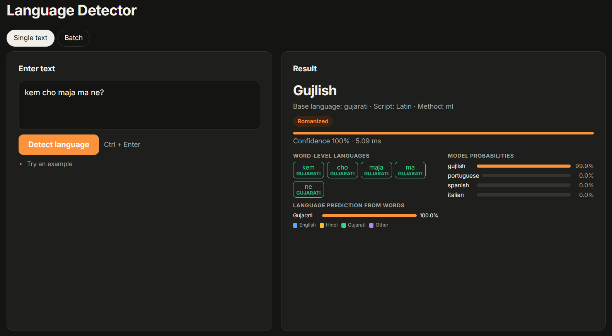

# Language Detection — English, Hindi, Gujarati, Hinglish, Gujlish & Gen Z

An NLP project that identifies the language of a piece of text. It handles:

| Category | Languages |
|---|---|
| **Core languages** | English, Hindi (हिन्दी), Gujarati (ગુજરાતી) |
| **Romanized (code-mixed)** | **Hinglish** (*"kaise ho bhai?"*)<br>**Gujlish** (*"kem cho maja ma ne?"*) |
| **Gen-Z style** 🔥 | Slang and shortforms in any of the above, shown as **Gujarati (Gen Z)**, **Hindi (Gen Z)**, **English (Gen Z)** (*"km 6o bhai, jalso padi gayo"*, *"bhai ye lowkey op hai fr"*, *"ngl this is bussin"*) — with the meaning of every slang word |
| **Other languages** | Marathi, Nepali, Bengali, Assamese, Punjabi, Odia, Tamil, Telugu, Kannada, Malayalam, Sinhala, Urdu, Arabic, Persian, Spanish, French, German, Italian, Portuguese, Russian, Ukrainian, Greek, Hebrew, Chinese, Japanese, Korean, Thai, Lao, Tibetan, Burmese, Khmer, Georgian, Armenian, Amharic |

For every text it returns the language, a confidence score, whether the text is
romanized, whether it is **code-mixed** (with a Code-Mixing Index), and a
**language tag for every word**. If the text is written in Gen-Z style, it
also returns a label like **Gujarati (Gen Z)** and decodes the slang it found.



---

## 1. Quick start

**Requirements:** Python 3.10 or newer.

### Option A — one command
```bash
# macOS / Linux
./run.sh

# Windows
run.bat
```
This creates a virtual environment, installs the libraries, trains the model if
needed, and starts the server. Then open:

* **Web app:** http://localhost:8000
* **Interactive API docs (Swagger):** http://localhost:8000/docs

### Option B — manual steps
```bash
python -m venv .venv
.venv\Scripts\activate
pip install -r requirements.txt
python training/train.py 
python -m uvicorn api.main:app --reload --port 8000
```

### Option C — Docker
```bash
docker build -t language-detection .
docker run -p 8000:8000 language-detection
```

> A trained model is already included in `models/`. If your scikit-learn version
> is different, the project notices and retrains automatically on first run.

---

## 2. Usage

### Web app
Type or paste text, click **Detect language**. The result shows the language,
confidence, romanized / code-mixed badges, colour-coded word-level tags and the
model's probabilities. The **Batch** tab detects many lines at once.

### Command line
```bash
python cli.py "kem cho maja ma ne?"
python cli.py "bro kal meeting hai office mein" --json
python cli.py --file my_sentences.txt
python cli.py                      # interactive mode
```
Example output:
```
Language   : Gujlish (Gujarati written in English letters)  [gujlish]
Confidence : 99.9%
Script     : Latin
Romanized  : yes (actual language: gujarati)
Words      : kem/gu cho/gu maja/gu ma/gu ne/gu
```
Gen-Z example:
```
$ python cli.py "km 6o bhai, jalso padi gayo"
Language   : Gujarati (Gen Z)  [gujlish]
Romanized  : yes (actual language: gujarati)
Gen-Z      : yes (score 2.2) - jalso padi gayo = had a blast, 6o = are (cho), km = how (kem)
```

### Python
```python
from detector import detect

r = detect("bhai aaje meeting che office ma")
print(r["language"])            # gujlish
print(r["base_language"])       # gujarati
print(r["is_code_mixed"])       # True
print(r["code_mixing_index"])   # 33.33
print(r["tokens"])              # [{'token': 'bhai', 'lang': 'gu', ...}, {'token': 'meeting', 'lang': 'en', ...}, ...]

r = detect("bhai ye lowkey op hai fr")
print(r["display_name"])        # Hindi (Gen Z)
print(r["genz_terms"])          # [{'term': 'lowkey', 'meaning': 'kind of / secretly'}, ...]
```

### REST API
```bash
curl -X POST http://localhost:8000/api/detect \
     -H "Content-Type: application/json" \
     -d '{"text": "kem cho maja ma ne?"}'
```
Full reference: **[docs/API.md](docs/API.md)**.

---

## 3. Results

Latin-script model, evaluated on **sentences never seen in training**
(train/test split is done *before* data augmentation, so there is no leakage):

| Model | Accuracy | Macro F1 |
|---|---|---|
| Naive Bayes (char 1-4 n-grams) | 89.3 % | 0.884 |
| Linear SVM (char 1-4 n-grams) | 94.3 % | 0.937 |
| **Logistic Regression (char 1-5 + word 1-2 n-grams) — used** | **95.0 %** | **0.958** |

Per-class F1 of the final model: English 0.97 · Gujlish 0.93 · Hinglish 0.92 ·
German 1.00 · French 0.99 · Italian 0.98 · Portuguese 0.94 · Spanish 0.94.

`python training/evaluate.py` also runs two small hand-written checks of the
full system:
* 74 sentences across 28 languages: **73 / 74 correct** (miss: *"bhai ek kaam kar ne"*, Gujlish → Hinglish).
* 33 Gen-Z / standard sentences: language **33 / 33**, Gen-Z flag **33 / 33**, no false Gen-Z alarms.

Those sets are small, so treat the held-out test-set figures above as the main measure.

Logistic Regression was chosen over the SVM because it outputs real
probabilities, which the system uses for confidence scores, the
"unknown language" threshold and blending with the lexicon.

Confusion matrix: `models/confusion_matrix.png`. Full numbers: `models/metrics.json`.

---

## 4. How it works (short version)

```
text ─► normalise ─► Unicode script of each word
                       │
      ┌────────────────┴─────────────────┐
  native script                      Latin script
  (ગુજરાતી, देवनागरी, தமிழ் …)        (English letters)
      │                                   │
  script → language rules            ML model: TF-IDF char + word n-grams
  + marker words for Devanagari      → Logistic Regression
    (Hindi / Marathi / Nepali)        + lexicon vote for short/unsure inputs
      │                                   │
      └──────────► word-level tags + Code-Mixing Index ◄──┘
                                  │
                     Gen-Z layer: slang / shortform lexicon
                     → "Gujarati (Gen Z)" + slang meanings
```

Gen Z is treated as a **style** of a language, not a new language, so
`language` stays `gujlish` / `hinglish` / `english` and the Gen-Z result is added
on top (`style`, `display_name`, `genz_score`, `genz_terms`).

Details: **[docs/ARCHITECTURE.md](docs/ARCHITECTURE.md)**. Full academic write-up
(abstract, literature review, methodology, results, limitations, references):
**[docs/PROJECT_REPORT.md](docs/PROJECT_REPORT.md)**.

---

## 5. Project structure

```
language-detection/
├── detector/                 # the core NLP library
│   ├── detector.py           # LanguageDetector – hybrid pipeline
│   ├── model.py              # ML pipeline (TF-IDF + Logistic Regression), load/save
│   ├── scripts.py            # Unicode script detection & script→language rules
│   ├── lexicons.py           # Hinglish / Gujlish / English / Devanagari word lists
│   ├── genz.py               # Gen-Z slang + shortform dictionary and scoring
│   └── normalizer.py         # cleaning & tokenisation
├── data/
│   ├── seed/*.txt            # ~1,000 hand-written sentences (8 classes)
│   ├── generate_dataset.py   # augmentation → processed/train.csv, test.csv
│   ├── eval_cases.csv        # end-to-end evaluation sentences (28 languages)
│   └── genz_eval.csv         # Gen-Z / standard evaluation sentences
├── training/
│   ├── train.py              # trains baselines + final model, saves metrics
│   └── evaluate.py           # end-to-end evaluation of the full system
├── models/                   # trained model, metrics.json, confusion_matrix.png
├── api/main.py               # FastAPI REST API (+ serves the web app)
├── frontend/index.html       # web interface
├── cli.py                    # command-line tool
├── tests/                    # 49 automated tests (pytest)
├── docs/                     # API.md, ARCHITECTURE.md, PROJECT_REPORT.md
├── requirements.txt
├── run.sh / run.bat          # one-command start
└── Dockerfile
```

---

## 6. Running the tests
```bash
python -m pytest -v
```

## 7. Extending the project
* **More data:** add sentences to `data/seed/<label>.txt`, then `python training/train.py`.
* **New romanized language** (e.g. romanized Marathi): create `data/seed/marathi_roman.txt`,
  add the label to `LABELS` in `data/generate_dataset.py`, add an entry in
  `LANGUAGE_INFO` in `detector/detector.py`, and retrain.
* **Better word-level tags:** add words to the lists in `detector/lexicons.py`.
* **New Gen-Z slang:** add a line to the right dictionary in `detector/genz.py`,
  e.g. `"aura farming": ("showing off coolness", 1.0),` — no retraining needed.
